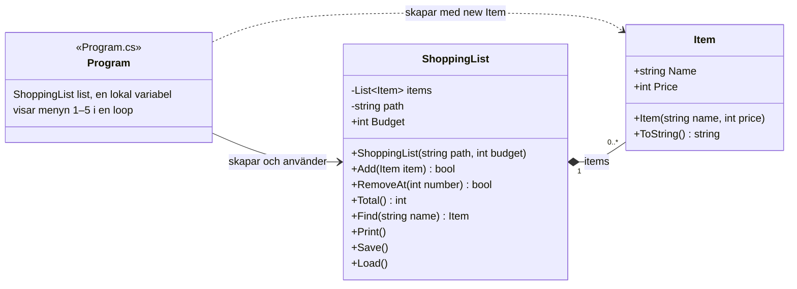

# Kunskapskontroll 2: Robust inköpslista

Startkoden är en inköpslista i C# som sparar varorna i `items.txt` mellan körningarna. Den byggde utan fel men fungerade inte. Här rättas felen ett i taget, i små steg.

## Kör programmet

Du behöver .NET 10 SDK. Öppna en terminal i mappen och kör:

```console
dotnet run
```

## Flödesschema

[Klickbart flödesschema över startkoden](https://aliteex55-bit.github.io/Del1-2brooor/flodesschema.html). Röda etiketter som 1-1 visar var felen fanns, fel och lager. I läget Lösning blir de gröna och visar koden efter lagningen.

## Felrapport

### Fel 1: programmet kraschade direkt vid start

**Vad hände:** programmet kraschade med `IndexOutOfRangeException` så fort det startade. `Save` skriver alltid en radbrytning sist, så även en fil som programmet själv hade sparat gav samma krasch vid nästa start.

**Varför:** `items.txt` har Windows-radbrytningar, `\r\n`, och slutar med en radbrytning. `Load` delade texten med `Split('\n')`. Det gav en tom sista rad, och en tom rad har ingen `parts[1]`. Samma delning lämnade `\r` kvar sist i varje namn, så sökningen hittade inga varor och `Save` lade till ett `\r` till vid varje sparning. En trasig rad i filen, till exempel `abc;Ost`, kraschade också.

**Så löstes det, i tre steg:**

1. Tomma rader hoppas över med `string.IsNullOrWhiteSpace` och `continue` ([f322a88](https://github.com/aliteex55-bit/Del1-2brooor/commit/f322a88)).
2. Filen läses med `File.ReadAllLines`, som tar bort hela radbrytningen. Namnen blir rätt och sökningen fungerar ([0d9247f](https://github.com/aliteex55-bit/Del1-2brooor/commit/0d9247f)).
3. En rad utan `;`, eller med ett pris som inte är ett heltal, hoppas över med ett meddelande. Priset läses med `int.TryParse` i stället för `int.Parse` ([e3dd039](https://github.com/aliteex55-bit/Del1-2brooor/commit/e3dd039)).

**Provat:** programmet startar med lärarens `items.txt`, sökningen hittar varorna som syns i listan, listan ser likadan ut efter sparning och omstart, och tomma eller trasiga rader kraschar inte.

### Fel 2: programmet kraschade när items.txt saknades

**Vad hände:** fanns inte `items.txt`, till exempel efter att man döpt om den, kraschade programmet direkt med `FileNotFoundException`. En fil som fanns men inte gick att läsa kraschade också: en fil som ett annat program hade låst gav `IOException`, och en fil som programmet saknade läsrätt till gav `UnauthorizedAccessException`.

**Varför:** `Load` läste filen utan att kontrollera att den fanns, och utan att hantera de fel som kan uppstå när en fil läses.

**Så löstes det, i två steg:**

1. Finns inte filen säger programmet till och börjar med en tom lista. Filen skapas första gången man sparar ([e81c5ac](https://github.com/aliteex55-bit/Del1-2brooor/commit/e81c5ac)).
2. Läsningen ligger i ett `try`, med en `catch` för `UnauthorizedAccessException` och en för `IOException`. Båda skriver ett svenskt meddelande, varnar för att en sparning skriver över filen och börjar med en tom lista ([d9a76a5](https://github.com/aliteex55-bit/Del1-2brooor/commit/d9a76a5)).

**Provat:** programmet startar utan `items.txt`, och efter sparning och omstart finns varorna kvar. En låst fil och en fil utan läsrätt ger ett meddelande i stället för en krasch.

### Fel 3: bokstäver i stället för tal kraschade programmet

**Vad hände:** menyvalet, priset och numret lästes med `int.Parse`. Bokstäver, en tom rad eller ett decimaltal gav `FormatException`, ett för stort tal gav `OverflowException`, och när inmatningen tog slut gav `int.Parse(null)` `ArgumentNullException`.

**Varför:** `int.Parse` kastar ett undantag när texten inte är ett heltal, och inmatning från en användare kan alltid bli fel.

**Så löstes det, i tre steg:**

1. Menyvalet läses med `int.TryParse`. Är det inte en siffra skrivs "Skriv en siffra mellan 1 och 5." och menyn visas igen. Tar inmatningen slut avslutas programmet i stället för att fråga om och om igen ([b8b8f7b](https://github.com/aliteex55-bit/Del1-2brooor/commit/b8b8f7b)).
2. Priset läses med `int.TryParse`. Är det inte ett heltal säger programmet till och lägger inte till någon vara ([ac710d1](https://github.com/aliteex55-bit/Del1-2brooor/commit/ac710d1)).
3. Numret läses med `int.TryParse`. Är det inte ett heltal säger programmet till och tar inte bort något ([871d175](https://github.com/aliteex55-bit/Del1-2brooor/commit/871d175)).

**Provat:** bokstäver, en tom rad, decimaltal, för stora tal och slut på inmatningen ger ett meddelande i stället för en krasch, både i menyn, i priset och i numret. Ett nummer som är ett heltal men inte finns i listan, till exempel 9, hör till fel 4.

### Fel 4: ett nummer som inte fanns i listan kraschade programmet

**Vad hände:** tog man bort ett nummer som inte fanns kraschade programmet med `ArgumentOutOfRangeException`. Det gällde till exempel `9` när listan hade två varor, `0`, `-1` och `1` i en tom lista.

**Varför:** `RemoveAt` tog bort på platsen `number - 1` utan att kontrollera att den platsen fanns. En plats i listan måste ligga mellan 0 och antalet varor minus 1.

**Så löstes det, i två steg:**

1. `RemoveAt` i `ShoppingList` kontrollerar att numret ligger mellan 1 och antalet varor. Annars tas ingenting bort, och metoden svarar `false` ([3e66885](https://github.com/aliteex55-bit/Del1-2brooor/commit/3e66885)).
2. `Program.cs` använder svaret och skriver att numret inte finns när det blev `false` ([b40382c](https://github.com/aliteex55-bit/Del1-2brooor/commit/b40382c)).

**Varför `false` och inte ett undantag:** ett nummer som inte finns händer ofta när man skriver fel, och programmet behöver bara säga till. Därför räcker ett enkelt `false`.

**Provat:** `9`, ett nummer för mycket, `0`, `-1` och `1` i en tom lista ger ett meddelande i stället för en krasch. Numren 1 och 2 tar bort rätt vara.

### Fel 5: totalsumman hoppade över första varan

**Vad hände:** totalsumman blev för låg. Med lärarens tre varor, 15 + 32 + 89 kr, visade programmet 121 kr i stället för 136 kr. Med en enda vara blev summan 0 kr. Programmet kraschade inte, så felet märktes bara om man räknade själv.

**Varför:** en lista räknar platser från 0, så första varan ligger på `items[0]`. Loopen i `Total` började på `i = 1`, så `items[0]` räknades aldrig med.

**Så löstes det:** loopen börjar på `i = 0` i stället för `i = 1` ([031bc55](https://github.com/aliteex55-bit/Del1-2brooor/commit/031bc55)).

**Provat:** lärarens `items.txt` ger 136 kr, en vara för 20 kr ger 20 kr, och en tom lista ger 0 kr. Summan stämmer också efter att en vara lagts till eller tagits bort.

### Fel 6: programmet sa att listan var sparad fast det misslyckades

**Vad hände:** gick det inte att spara skrev programmet ändå "Listan är sparad.". Med en skrivskyddad `items.txt`, och med en fil som ett annat program höll öppen, fick man bekräftelsen, men den nya varan kom aldrig in i filen. Felet syns inte när man kör programmet som vanligt, bara när sparandet misslyckas.

**Varför:** `catch`-blocket i `Save` var tomt och fångade alla sorters fel, så felet försvann utan ett ord. Raden med "Listan är sparad." låg efter `try` och `catch` och kördes därför alltid.

**Så löstes det, i två steg:**

1. Den tomma `catch` blev två specifika `catch`, en för `UnauthorizedAccessException` och en för `IOException`. Båda säger vad som gick fel och att listan inte sparades ([810efa5](https://github.com/aliteex55-bit/Del1-2brooor/commit/810efa5)).
2. "Listan är sparad." flyttades in i `try`, direkt efter `File.WriteAllText`. Kastar skrivningen ett undantag körs raden aldrig, så bekräftelsen syns bara när det gick ([f560715](https://github.com/aliteex55-bit/Del1-2brooor/commit/f560715)).

**Provat:** en vanlig fil ger "Listan är sparad.", och varan finns i filen. En skrivskyddad fil och en fil som ett annat program har öppen ger bara meddelandet att listan inte sparades, och filen är oförändrad.

## Utbyggnad

### U1: Item vägrar ogiltiga värden

**Vad krävdes:** konstruktorn i `Item` ska vägra ett tomt namn med `ArgumentException` och ett negativt pris med `ArgumentOutOfRangeException`, i stället för att tyst skapa ett trasigt objekt. Programmet ska inte krascha, och användaren ska få veta vad som hände.

**Före:** ett tomt namn lades till som en vara utan namn, och priset -5 lades till som "Te - -5 kr". Rader som `15;` och `-5;Ost` i `items.txt` blev också sådana varor.

**Så gjordes det, i två steg:**

1. Tomt namn: `Item` kastar `ArgumentException`. `Program.cs` fångar det och säger att namnet inte får vara tomt, och `Load` hoppar över raden med ett meddelande ([9359127](https://github.com/aliteex55-bit/Del1-2brooor/commit/9359127)).
2. Negativt pris: `Item` kastar `ArgumentOutOfRangeException`. `Program.cs` och `Load` fångar det i en egen `catch` före `catch (ArgumentException)`. Ordningen behövs eftersom `ArgumentOutOfRangeException` är en sorts `ArgumentException`, och programmet tar den första `catch` som passar ([039d36c](https://github.com/aliteex55-bit/Del1-2brooor/commit/039d36c)).

**Provat:** ett tomt namn, ett namn med bara mellanslag och priserna -5 och -1 ger ett meddelande, och ingen vara läggs till. 0 kr är tillåtet. I filen hoppas `15;` och `-5;Ost` över med meddelanden, och resten av listan läses in.

### U2: Listan har ett budgettak

**Vad krävdes:** `ShoppingList` ska ha ett tak för hur dyr hela listan får bli, och en vara som skulle spränga taket ska inte läggas till. Hur `Add` säger nej är ett eget designval som ska motiveras. Användaren ska få ett begripligt meddelande, och programmet ska fortsätta köra.

**Före:** listan hade inget tak. En vara för 5000 kr lades till i lärarens lista på 136 kr som vanligt, och två varor för `2147483647` kr, det största talet en `int` rymmer, gav `Totalt: 134 kr`, eftersom summan slog runt.

**Så gjordes det, i tre steg:**

1. `ShoppingList` får taket `Budget` i konstruktorn, och `Program.cs` skapar listan med 1000 kr. `Add` svarar `false` och lägger inte till något när summan skulle gå över taket. I kontrollen görs `Total()` om till `long` innan priset läggs till, så att summan inte kan slå runt till ett negativt tal och smita under taket ([715f99e](https://github.com/aliteex55-bit/Del1-2brooor/commit/715f99e)).
2. `Program.cs` använder svaret från `Add`. Är det `false` skrivs vilken vara som inte ryms, taket och hur mycket som finns kvar ([e2b0021](https://github.com/aliteex55-bit/Del1-2brooor/commit/e2b0021)).
3. `Load` lägger också till varorna från filen via `Add`. En rad som inte ryms hoppas över med ett meddelande, så inte heller filen kan ge en lista över taket ([f106181](https://github.com/aliteex55-bit/Del1-2brooor/commit/f106181)).

#### Designval: `Add` säger nej genom att returnera `false`, inte genom att kasta ett undantag

Att en vara inte ryms i budgeten är inget fel i programmet. Det händer i vanlig användning, när någon försöker lägga till något som är för dyrt. `Add` kan bara säga nej av en enda anledning, taket, så den som anropar behöver bara veta ja eller nej, och det räcker med en `if`. Siffrorna i meddelandet hämtar `Program.cs` från `list.Budget` och `list.Total()`. Med ett undantag skulle både `Program.cs` och `Load` behöva `try` och `catch` runt `Add`, och en glömd `catch` skulle få programmet att krascha. Det är samma sätt som `RemoveAt` i fel 4 och som bankexemplet i uppgiften, där ett uttag returnerar `false` när saldot inte räcker.

`Item` kastar däremot undantag (U1). Ett `Item` med tomt namn eller negativt pris får aldrig finnas, och en konstruktor kan inte svara `false`. En vara som inte ryms är i stället ett giltigt objekt som just den här listan säger nej till.

Nackdelen med `false` är att man kan glömma att titta på svaret. Då försvinner varan utan ett ord, vilket syntes efter steg 1. Därför läser både `Program.cs` och `Load` svaret.

**Vad `Program.cs` gör med svaret:** den kollar svaret med `if (!list.Add(item))`. Är det `false` skrivs till exempel "Tv för 5000 kr ryms inte i budgeten på 1000 kr (det finns 864 kr kvar). Varan lades inte till.", och menyn visas igen. Är det `true` behövs inget mer, och varan syns i listan när menyn visas igen. `Program.cs` hanterar alltså två saker på två sätt: `try` och `catch` runt `new Item(...)` för det ogiltiga objektet, och `if` runt `list.Add(item)` för taket. `Load` gör samma sak med en rad i filen: "En rad i items.txt ryms inte i budgeten på 1000 kr och hoppades över: 2000;Tv".

**Provat:** 864 kr till lärarens 136 kr ger exakt 1000 kr. 865 kr, 5000 kr och `2147483647` kr läggs inte till, och programmet säger hur mycket som finns kvar. 0 kr går att lägga till även när listan är på 1000 kr. En `items.txt` med `2000;Tv` hoppas över med ett meddelande, och med 900, 200 och 100 kr läses 900 kr och 100 kr in. Tomt namn, negativt pris och bokstäver i priset ger samma meddelanden som förut.

**Bra att veta:** raderna i filen läses uppifrån och ner, så ordningen avgör vilka varor som kommer med. En rad som hoppats över försvinner ur filen nästa gång man sparar, precis som en trasig rad.

## Klassdiagram

Programmet efter ändringarna, i tre rutor. `+` betyder `public` och `-` betyder `private`.



- **Program** är `Program.cs`, därav märket `<<Program.cs>>`. Filen har ingen egen klass i koden, eftersom den använder toppnivåsatser (top-level statements), men kompilatorn lägger raderna i en metod i en klass som heter `Program`. Den skapar listan med budgettaket 1000 kr, visar menyn och skapar en `Item` av namnet och priset som användaren skriver. `list` har inget `+` eller `-`, för den är en lokal variabel och inte ett fält.
- **ShoppingList** har varorna i listan `items` och sparar dem i filen `path`. `Budget` kan bara läsas, den sätts i konstruktorn. `Add` och `RemoveAt` returnerar `true` eller `false`. `Load` läser filen (`items.txt`), skapar en `Item` av varje rad som går att läsa och lägger in den med `Add`. `Save` skriver filen.
- **Item** är en vara med namn och pris. Konstruktorn kastar `ArgumentException` för ett tomt namn och `ArgumentOutOfRangeException` för ett negativt pris.

Den heldragna pilen betyder att `Program` skapar och använder en `ShoppingList`, som finns i variabeln `list` hela körningen. Den streckade pilen betyder att `Program` bara skapar `Item`-objekt med `new Item(...)` och lämnar över dem till `Add`. Den fyllda romben (komposition) betyder att en `ShoppingList` äger sina `Item` i listan `items`, och `1` och `0..*` betyder att en lista har noll eller flera varor.
